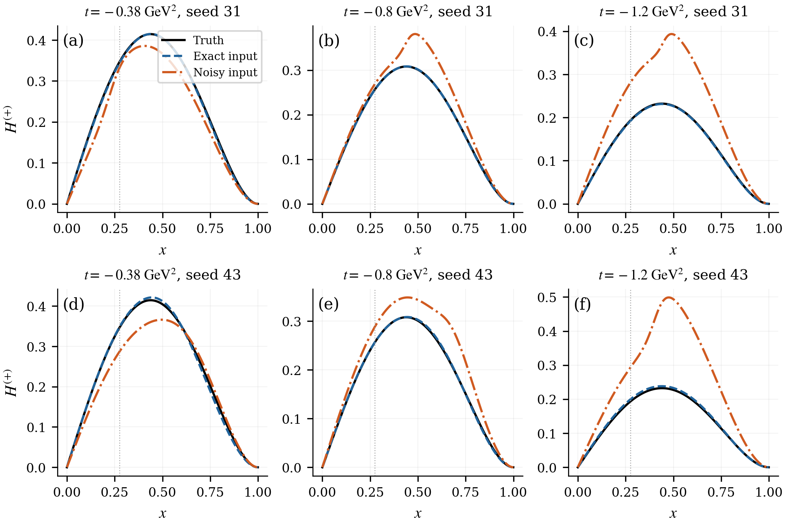
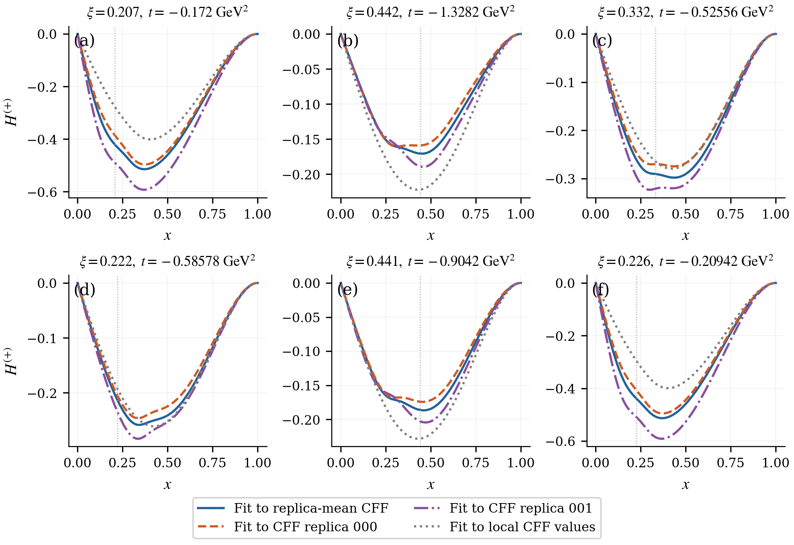
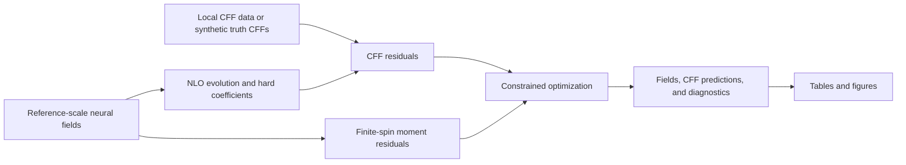

# Neural GPD reconstruction with NLO QCD

This repository reconstructs generalized parton distributions (GPDs) from Compton form factors (CFFs). A neural network represents quark and gluon fields at a reference scale; next-to-leading-order QCD evolution and hard coefficients connect those fields to the observed amplitudes. The analysis follows the reconstruction from exact-input closure to uncertain experimental inputs and complementary forward information.

The repository includes the analysis scripts, all six current manuscript plots, their numerical inputs, and 54 saved model states. The figures and tables can be regenerated locally. Model evaluation also reproduces the closure field errors and experimental CFF predictions without retraining.

[Reproduce the analysis](analysis/README.md) · [Figure gallery](docs/figures.md) · [Method](docs/method.md) · [Results](docs/results.md) · [Software guide](docs/software.md) · [Related work](docs/literature.md)

## Start with the results

Use Python 3.9 or newer in a virtual environment. For tables and plots, only NumPy, pandas, and Matplotlib are needed:

```bash
git clone https://github.com/zetanaut/GPD-inverse-integral.git
cd GPD-inverse-integral
python -m pip install -r analysis/requirements.txt
python analysis/reproduce.py
```

Outputs go to `outputs/analysis/`: six PDF figures, six PNG previews, seven CSV tables, a readable results summary, and verification reports. Inputs are checked against a SHA-256 manifest before analysis. No fit is performed and no new noise is drawn.

To also evaluate the saved models and replay the experimental NLO predictions:

```bash
python -m pip install -e '.[dev,plot]'
python analysis/reproduce.py --replay-checkpoints
python -m pytest -q
python tools/verify_sources.py
```

The [reproduction guide](analysis/README.md) explains each command, data format, metric, and validation level. Repeating an optimization campaign requires more than replaying its saved outputs; the [research workflow map](docs/workflows.md) identifies the relevant fit, scoring, and cluster scripts and their runtime dependencies.

## Follow the scientific progression

| Step | Question | Evidence and entry point |
|---|---|---|
| 1. Define the inverse problem | Which fields are inferred, and how do they produce CFFs? | [Reference fields, NLO map, and moment constraints](docs/method.md) |
| 2. Establish exact-input recovery | Can the method recover a known GPD from integral observations? | [Figures 1–2](docs/figures.md#1-exact-input-multiscale-closure): 45 complex-CFF positions and 512 disjoint prediction positions |
| 3. Introduce experimental-scale noise | How does the inferred field respond to a fixed perturbation? | [Figure 3](docs/figures.md#3-exact-and-noisy-real-cff-inputs): exact/noisy real CFFs at 160 experimental coordinates, two initializations |
| 4. Reconstruct experimental fields | What GPDs reproduce local CFF values, a mean CFF function, or individual CFF replicas? | [Figures 4–5](docs/figures.md#4-experimental-gpd-slices) and a common-data residual comparison |
| 5. Examine the reconstruction rule | Does the response depend on the number of optimization iterations? | [Figure 6](docs/figures.md#6-dependence-on-optimization-iterations), matched input/output responses, and mean-distance decomposition |
| 6. Add complementary information | Does a forward-boundary constraint improve the quantities of interest? | [CFF-only versus CFF+PDF comparison](docs/results.md#forward-information-comparison) with exact and half-noise inputs |

### Exact inputs and noise sensitivity

| CFF input | Positions | Initialization | Wider-chart GPD error |
|---|---:|---:|---:|
| Exact complex CFFs | 45 | 31 | 4.90% |
| Exact real CFFs | 160 | 31 | 0.75% |
| Exact real CFFs | 160 | 43 | 3.05% |
| Noisy real CFFs | 160 | 31 | 32.69% |
| Noisy real CFFs | 160 | 43 | 49.21% |

These are relative L2 errors of the charge-weighted field for one analytic generating GPD. The noisy runs share one perturbation vector at the quoted error scale. Different sampling geometries and loss weights prevent interpreting the 45-versus-160 comparison as a test of whether imaginary CFF information is useful.



The exact complex-CFF fit predicts real and imaginary CFFs at 512 disjoint positions with relative errors of 0.75% and 2.75%. Its separate singlet and nonsinglet errors are much larger than the error in their charge-weighted sum; the result does not establish flavor separation. [Definitions and full comparison](docs/results.md#exact-input-closure)

### Experimental inputs and the reconstructed family

The experimental analysis uses 160 retained local real-CFF extractions. Thirty-two perturbed input vectors are each fitted with a smooth CFF network. GPD fits use either the pointwise mean of those CFF functions or individual replicas 000 and 001. A separate local-CFF fit uses the unperturbed local values directly.



| GPD fit | RMS residual against its own CFF target | RMS residual against the same local CFF values |
|---|---:|---:|
| Local CFF values | 2.43350 | 2.43350 |
| Replica-mean CFF | 1.32583 | 2.17274 |
| CFF replica 000 | 1.52782 | 2.19179 |
| CFF replica 001 | 1.58418 | 2.12619 |

All residuals are divided pointwise by the original quoted errors. The mean and individual-replica fits use 20 additional outer iterations from a common starting network. The local-CFF fit has a different optimization history, so this comparison does not isolate the effect of smoothing. The GPD fitted to the mean CFF is **not an average of reconstructed GPDs**. Two propagated replicas illustrate input sensitivity; they do not define a statistical uncertainty band.

## How the method works

The network represents three fields at a common reference scale:

$$\boldsymbol F_\theta(x,\xi,t;Q_0^2)=(\Sigma,T,H_g),\qquad Q_0^2=2\ \mathrm{GeV}^2.$$

With $U=H^u(x)-H^u(-x)$ and analogous $D,S$, the basis is $\Sigma=U+D+S$, $T=U-(D+S)/2$, and $H_g(x,0,0)=xg(x)$. The reported charge-weighted quark GPD is

$$H^{(+)}=\frac{2}{9}(\Sigma+T).$$



The 3,867-parameter FiLM network imposes quark/gluon parity and even skewness dependence exactly. Finite-spin polynomiality constrains the moment space while leaving the allowed coefficients free. There is no Q² input to the network: scale dependence comes from the QCD map. Reusable numerical rows keep the physics map explicit during optimization. [Equations, conventions, and implementation](docs/method.md)

## Repository map

| Location | Contents |
|---|---|
| [`analysis/`](analysis/README.md) | Runnable analysis, plotting, checkpoint replay, saved numerical inputs, and figure previews |
| [`src/gpd_reh/`](src/gpd_reh) | FiLM fields, exact-coordinate NLO rows, input conventions, moment constraints, and residual derivatives |
| [`src/gpd_tools/`](src/gpd_tools) | Solver, calibration, PDF-observation, truth-generator, and cache components |
| [`data/experimental/`](data/experimental) | Source CFF table, 160 prepared observations, and 102 nominal/reference NLO row pairs |
| [`examples/`](examples) | Small forward-interface and artificial-record calibration demonstrations |
| [`research/`](research/README.md) | Original fitting, upstream-CFF, scoring, numerical-kernel, and cluster workflow sources |
| [`evidence/`](evidence) | Bound scientific review records and distribution-validation reports |
| [`tests/`](tests) | Model, convention, derivative, calibration, and analysis checks |
| [`SOURCE_MANIFEST.json`](SOURCE_MANIFEST.json) | Source paths, hashes, and declared adaptations |

The original LO inversion and plotting utilities remain available at their original paths, with [compatibility instructions](docs/legacy.md). They use a different checkpoint format from the current three-channel fields.

The [literature guide](docs/literature.md) positions this work relative to neural CFF extraction, neural GPD reconstruction, lattice-informed methods, non-neural GUMP, and Gaussian-process reconstruction. The associated manuscript uses [arXiv:2512.21761](https://arxiv.org/abs/2512.21761); identify the repository commit and analysis snapshot when reproducing these results.

Tiktaalik-derived sources retain their [upstream license](research/GPD_NLO_completion_package/frozen/fortran/LICENSE.tiktaalik). See [third-party notices](THIRD_PARTY_NOTICES.md) for scope. No new blanket license is assigned to the authors' code by this update.
