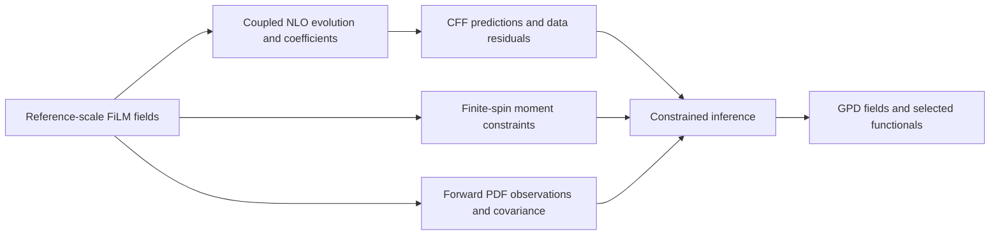

# Neural GPD reconstruction with NLO QCD

Physics-constrained neural inference of generalized parton distributions from Compton form factors, with coupled quark/gluon evolution, free-coefficient moment constraints, and complementary forward information.

**Research software and results through 30 October 2026.** This repository now contains the current framework alongside the original LO inversion and plotting tools. The revised manuscript will replace the earlier Watkins–Keller paper on the [same arXiv record, 2512.21761](https://arxiv.org/abs/2512.21761), once its results and manuscript are ready. The arXiv page currently describes the earlier version.

[Methods note (PDF)](docs/GPD_AI_Methods_Proposal_Note.pdf) · [Physics and conventions](docs/method.md) · [Results and limitations](docs/results.md) · [Software guide](docs/software.md) · [Literature](docs/literature.md) · [Original tools](docs/legacy.md)

## Current method

A conditional FiLM network represents the reference-scale fields

$$F_\theta(x,\xi,t;Q_0^2)=(\Sigma,T,H_g),\qquad Q_0^2=2\ \mathrm{GeV}^2.$$

For the stored three-flavor basis, $\Sigma=U+D+S$, $T=U-(D+S)/2$, and $H_g(x,0,0)=xg(x)$. Here $U=H^u(x)-H^u(-x)$, with analogous definitions for $D,S$. The reported charge-weighted quark combination is

$$H^{(+)}=\frac{2}{9}(\Sigma+T).$$

The fixed NLO forward calculation maps reference-scale fields to complex CFF predictions. Scale dependence enters through QCD evolution and hard coefficients. The current experimental fits use Re $\mathcal H$; an unfitted imaginary prediction supplies no additional measurement.



Implemented components include:

- A 3,867-parameter reference-scale network with exact quark/gluon parity, even skewness dependence, active t conditioning, and an explicit endpoint envelope.
- Fixed-t Mellin constraints for even spins 2, 4, 6, and 8. Allowed polynomial coefficients remain unknown; the code penalizes components outside the allowed spaces.
- Exact-coordinate NLO row adapters, paired nominal/reference banks, integrated residual derivatives, and finite-budget constrained optimization components.
- Correlated forward-PDF observations, using the stored channel conventions and explicit covariance whitening.
- Synthetic truth generators, closure workflows, selected-functional error calibration, and separate symbolic moment-support proposals followed by refitting.

This is a reduced channel basis: recovery of $H^{(+)}$ alone does not identify all flavors, $E$, angular momentum, or mechanical distributions. Finite-spin collocation is not an all-orders polynomiality guarantee. See [method and assumptions](docs/method.md).

## Install and run

Use Python 3.9 or newer in your preferred virtual environment:

```bash
git clone https://github.com/zetanaut/GPD-inverse-integral.git
cd GPD-inverse-integral
python -m pip install -e '.[dev,plot]'
python examples/quickstart.py
python examples/calibration.py
python -m pytest -q
```

The quickstart evaluates a fresh neural field through the bundled validated NLO rows and reports a moment residual. It performs no fit; its numbers are interface demonstrations, not reconstructed physics. The calibration example illustrates the statistical API using artificial error records.

The source checkout includes the 189-row source CFF table (160 rows after the declared cuts), 102 exact-coordinate NLO row pairs, and a smaller development fixture for interface tests. Package installation alone does not fetch these data from another service. [Data provenance and supported workflows](docs/software.md#data-and-reproduction) describe the inputs, sign convention, and requirements for full research runs.

## Completed evidence

The forward-PDF study, P2B, compares a CFF-only baseline with a joint CFF-plus-PDF fit. The following errors are percentages relative to the same synthetic truth:

| Case | Observed-slice $H^{(+)}$ L2 | Absolute relative error in A | Absolute relative error in B | Wider-chart $H^{(+)}$ L2 |
|---|---:|---:|---:|---:|
| Exact CFF baseline | 0.9203 | 0.4848 | 0.8691 | 0.7502 |
| Exact CFF + PDF | 0.4695 | 0.6767 | 0.2516 | 0.5353 |
| Half-noise CFF baseline | 11.4635 | 4.9896 | 1.2814 | 28.6127 |
| Half-noise CFF + PDF | 10.1336 | 3.5404 | 3.2364 | 38.1344 |

At $\xi=0.275$, $t=-0.363\ \mathrm{GeV}^2$, $Q_0^2=2\ \mathrm{GeV}^2$,

$$A=5\int_{0.2}^{0.4}H^{(+)}dx,\qquad B=\int_0^1 xH^{(+)}dx.$$

The clean-input control passes its four preservation gates. The single frozen half-noise case improves squared observed-slice error by 21.86% and improves A, but fails B's no-worsening safeguard and worsens the wider chart. This limits the claim of robust benefit from this PDF addition; it does not by itself prevent publication of the broader framework. Independent assessment for this P2B design remains unreleased.

A separate 442-case study achieved joint selected-target coverage of 135/141 and 131/141 on its two synthetic test strata. It does not calibrate experimental or full-field bands. Other completed studies include complex-CFF closure, actual-coordinate ReH closure, symbolic refits, numerical consistency checks, and information-limit diagnostics. Their settings and metrics are documented separately in [results](docs/results.md).

## Software map

| Location | Contents | Use |
|---|---|---|
| [`src/gpd_reh`](src/gpd_reh) | FiLM fields, input conventions, NLO row adapter, fixed-t moments, residual/Jacobian problem | Importable current inference components |
| [`src/gpd_tools`](src/gpd_tools) | Calibration, PDF observation adapter, synthetic truths, solver primitives, exact-input cache, row importer | Reusable research tools |
| [`examples`](examples) | Forward/model and calibration examples | Small local demonstrations |
| [`tests`](tests) | Existing scientific interface and calibration checks | No optimization campaign |
| [`data/experimental`](data/experimental) | Source CFF table, prepared observations, validated row pairs | Declared experimental geometry |
| [`research`](research) | Numerical kernels, evolution, fitting workflows, closure, symbolic, upstream, and P2B source snapshots | Advanced workflows with original runtime contracts |
| [`evidence`](evidence) | Compact review records and source metrics | Traceability of reported results |
| [`SOURCE_MANIFEST.json`](SOURCE_MANIFEST.json) | Original project paths, hashes, and import adaptations | Source provenance |

## Original tools retained

`GPD-H_pt.py`, `3d-update.py`, `Q2-plots.py`, `plot_H_band_pt.py`, `plot_H_surface_band_pt.py`, and `plot_gpd_surface_band_simple.py` remain at their original paths. They support the earlier LO model/checkpoint format and are useful for historical reproduction and visualization. They do not directly load the new three-channel FiLM checkpoints. The [original instructions](docs/legacy.md) are preserved with that scope.

## Publication context and development

Neural GPD representation, neural CFF inference, and global NLO extraction all have precedents. The contribution here is the specific inference formulation and the evidence for what it can recover. [The literature guide](docs/literature.md) covers theory-constrained neural GPDs, NNGPD, lattice and pion neural studies, CFF-only fits, GUMP1.0, and Gaussian-process reconstruction.

The revised paper will present the current framework, numerical checks, completed reconstructions, uncertainty scope, and remaining ambiguities. The earlier LO formulation can provide an informative ablation. The repository update does not announce a completed manuscript or a new arXiv version.

Sources derived from Tiktaalik retain their [upstream license](research/GPD_NLO_completion_package/frozen/fortran/LICENSE.tiktaalik); see [third-party notices](THIRD_PARTY_NOTICES.md). No new blanket license is assigned to the authors' code by this update.
