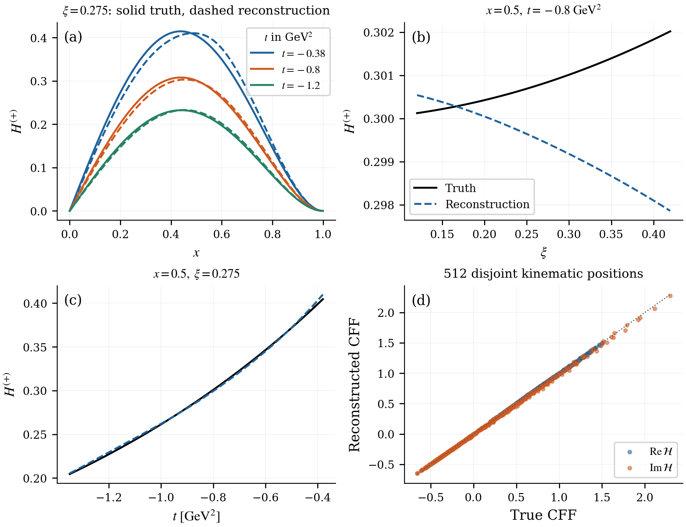
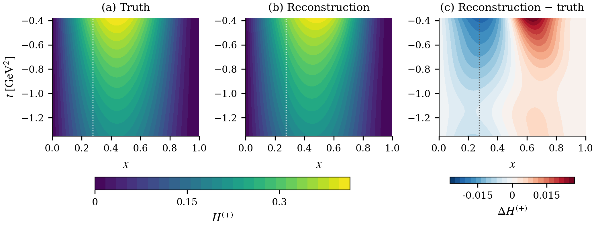
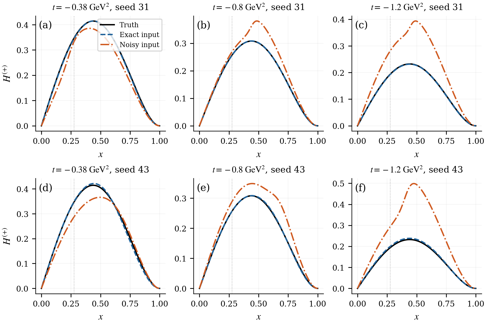
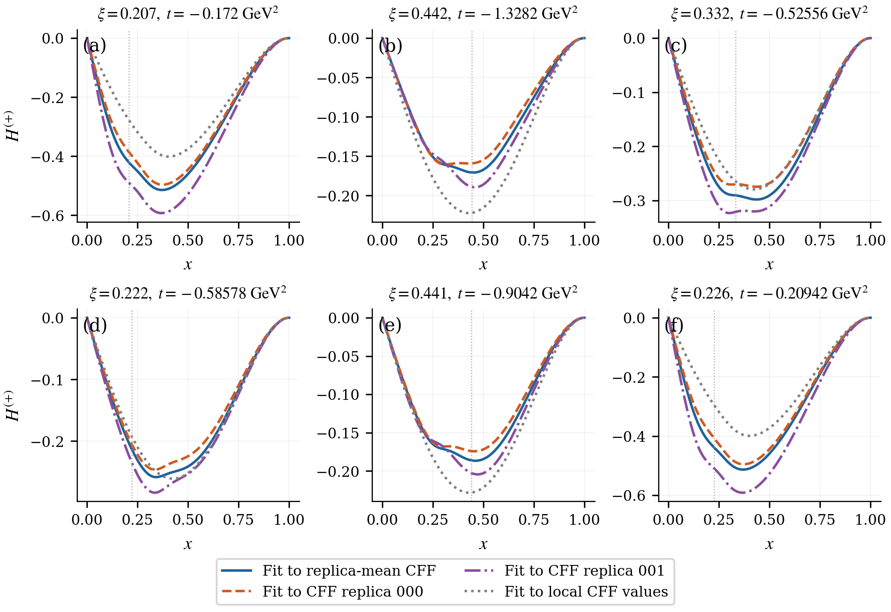
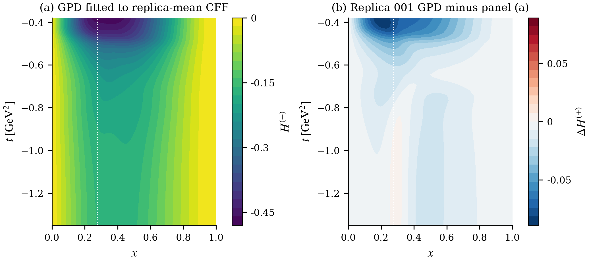
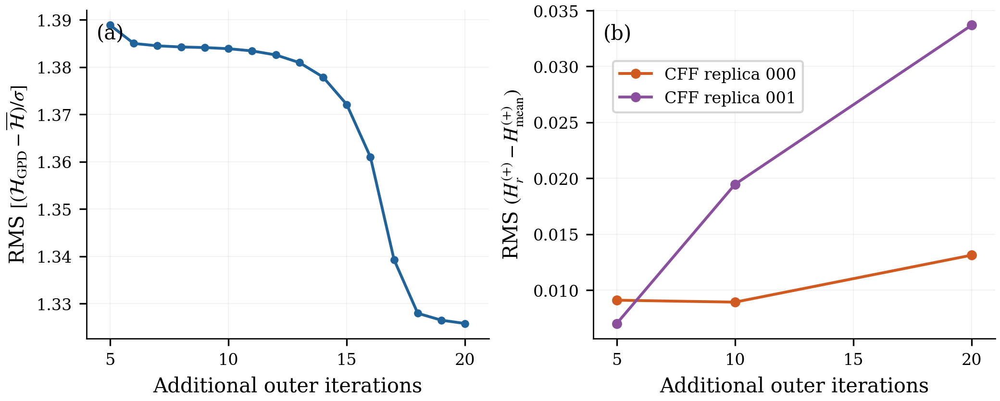

# Figure gallery and source map

All six figures use saved results at the reference scale $Q_0^2=2$ GeV². Run `python analysis/reproduce.py` from the repository root to regenerate the PDF and PNG versions. The [analysis guide](../analysis/README.md) gives the metric definitions and replay options.

## 1. Exact-input multiscale closure

[Vector PDF](../analysis/figures/fig01_exact_closure.pdf) · [Saved arrays](../analysis/data/ideal_L0_Z1_s31.npz) · [Scores](../analysis/data/ideal_L0_Z1_s31_scores.json)

The fit uses 45 complex CFF input positions. Panels (a–c) compare the generating charge-weighted GPD with the fitted field as x, skewness, or momentum transfer varies. Panel (d) compares complex CFF predictions with truth at 512 disjoint kinematic positions. The reconstructed field has a 4.90% wider-chart relative L2 error, while the disjoint real/imaginary CFF errors are 0.75%/2.75%. Visible skewness-shape differences remain despite the small overall norm.

## 2. Exact-input surface

[Vector PDF](../analysis/figures/fig02_exact_surface.pdf) · [Surface arrays](../analysis/data/sampled_surfaces.npz)

The first two panels share a color scale and show truth and reconstruction at xi=0.275. The third panel shows reconstruction minus truth on its own signed scale. The dotted line marks x=xi. The values come from evaluating the saved field, rather than fitting an additional surface.

## 3. Exact and noisy real-CFF inputs

[Vector PDF](../analysis/figures/fig03_exact_noisy.pdf) · [Exact seed 31](../analysis/data/exp_Re_exact_Z1_s31.npz) · [Exact seed 43](../analysis/data/exp_Re_exact_Z1_s43.npz) · [Noisy seed 31](../analysis/data/exp_Re_noisy_Z1_s31.npz) · [Noisy seed 43](../analysis/data/exp_Re_noisy_Z1_s43.npz)

The two rows use different network initializations; both see the same noisy vector. Black is truth, blue is reconstruction from exact CFF inputs, and orange is reconstruction from perturbed CFF inputs. Only real CFFs at the 160 experimental coordinates enter these fits. This is a matched noise-sensitivity example, not a repeated-draw uncertainty ensemble.

## 4. Experimental GPD slices

[Vector PDF](../analysis/figures/fig04_experimental_family.pdf) · [Mean/replica curves](../analysis/data/experimental_family.csv) · [Local-CFF curves](../analysis/data/experimental_nominal.csv)

Blue is the GPD fitted to the pointwise mean of 32 smooth CFF replicas. Orange and purple fit individual CFF replicas 000 and 001. These three fits use 20 additional iterations from the same starting network. Gray is the separate GPD fitted directly to the 160 unperturbed local CFF values. Six preselected anchors are shown. The mean-CFF fit is not an average of reconstructed GPDs, and the two individual replicas do not establish a confidence band.

The fields can be negative in this convention and finite-t domain. The fits impose neither a forward-PDF boundary nor a complete positivity condition. Sign alone is not a positivity test.

## 5. Experimental GPD surface and response

[Vector PDF](../analysis/figures/fig05_experimental_surface.pdf) · [Surface arrays](../analysis/data/sampled_surfaces.npz)

Panel (a) is the GPD fitted to the mean CFF function at xi=0.275. Panel (b) is the GPD fitted to replica 001 minus panel (a), after the same 20 additional iterations. Both panels contain GPD quantities. They have different color scales; the difference is one signed response, not a standard deviation.

## 6. Dependence on optimization iterations

[Vector PDF](../analysis/figures/fig06_budget_response.pdf) · [All saved stages](../analysis/data/budget_stages.csv) · [Field response](../analysis/data/budget_response.csv)

Panel (a) measures the RMS difference between the mean-CFF GPD prediction and its CFF target in original error units. Panel (b) measures the full-x slice RMS difference between each replica GPD and the mean-CFF GPD at the same iteration count. The CFF residual decreases modestly while the field response grows. The comparison establishes dependence on the stopping rule, rather than a converged experimental uncertainty estimate.

The plotting implementation is [make_figures.py](../analysis/make_figures.py). Numerical table and response calculations are in [analyze_results.py](../analysis/analyze_results.py); model evaluation and field-error checks are in [replay_checkpoints.py](../analysis/replay_checkpoints.py).
