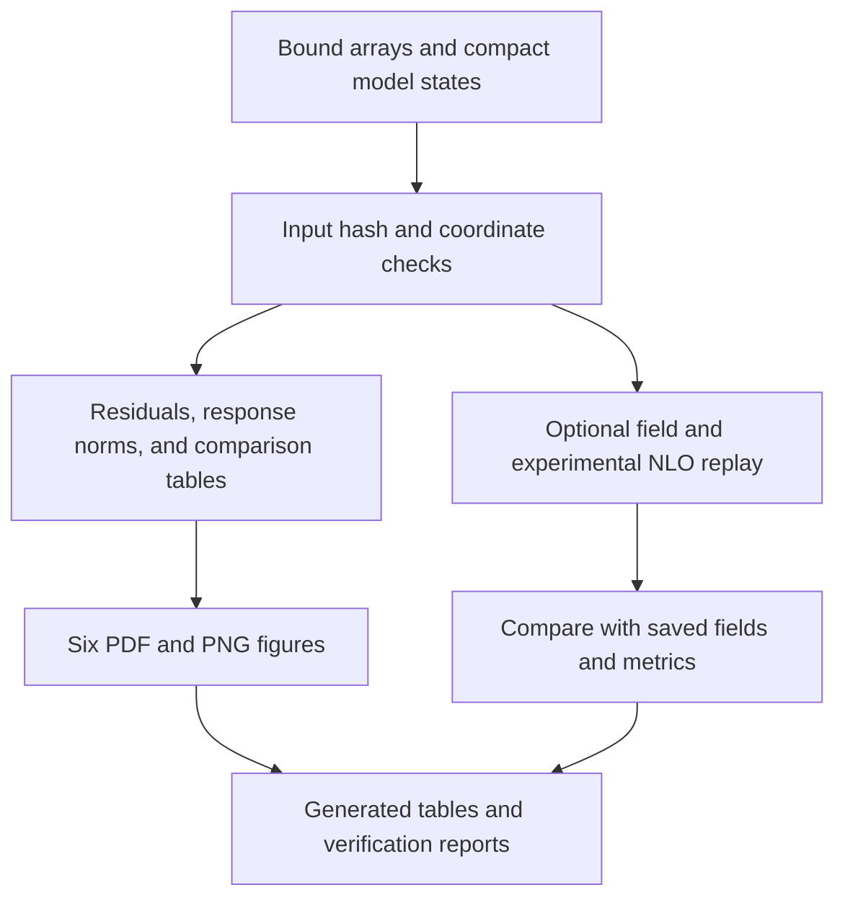

# From inputs to inference, analysis, and plots

The public saved-result workflow is fully local. The original fitting and numerical workflows are also supplied for inspection and extension, with their additional runtime requirements stated below. The progression is organized by the scientific computation, not the sequence of development jobs.

## Runnable saved-result path

| Operation | Entry point | Inputs and outputs |
|---|---|---|
| Regenerate the complete analysis | [`analysis/reproduce.py`](../analysis/reproduce.py) | Frozen `analysis/` inputs → `outputs/analysis/` |
| Recompute numerical comparisons | [`analysis/analyze_results.py`](../analysis/analyze_results.py) | Saved arrays/records → seven CSV tables and checks |
| Render all manuscript figures | [`analysis/make_figures.py`](../analysis/make_figures.py) | Saved arrays → six PDF and six PNG files |
| Reevaluate saved fields and experimental CFFs | [`analysis/replay_checkpoints.py`](../analysis/replay_checkpoints.py) | 54 NPZ states and bundled row bank → fields, predictions, residuals |
| Export states from an original workspace | [`tools/export_analysis_states.py`](../tools/export_analysis_states.py) | Source-hashed original checkpoints → portable state arrays |
| Verify imported source files | [`tools/verify_sources.py`](../tools/verify_sources.py) | Repository source manifest → integrity report |

See the [analysis guide](../analysis/README.md) for commands and exact numerical scope.

## Source map for the underlying scientific workflows

Paths below are relative to `research/`. Original project-relative layouts are retained because scripts bind configurations, source hashes, and runtime artifacts. Their presence does not make a complete optimization campaign available from a fresh clone alone.

| Stage | Principal source entry points | Role / additional requirements |
|---|---|---|
| Prepare experimental inputs | [`GPD_ReH_experimental_run/prepare_run.py`](../research/GPD_ReH_experimental_run/prepare_run.py), [`gpd_reh/inputs.py`](../src/gpd_reh/inputs.py) | Apply declared cuts, source convention, and coordinate normalization. Compact prepared inputs are already bundled. |
| Build and import QCD rows | [`GPD_ReH_experimental_run/export_experimental_rows.py`](../research/GPD_ReH_experimental_run/export_experimental_rows.py), [`import_validated_rows.py`](../research/GPD_ReH_experimental_run/import_validated_rows.py) | Connect the source-derived evolution/hard map to exact coordinates; native runtime and operator caches are needed to rebuild rows. |
| Run exact and noisy closures | [`GPD_three_stage_closure/run_coarse_case.py`](../research/GPD_three_stage_closure/run_coarse_case.py), [`run_real_only_case.py`](../research/GPD_three_stage_closure/run_real_only_case.py) | Fit with the declared initialization, objective, solver, and numerical-domain conditions. Requires prepared observations and the corresponding maps/runtime. |
| Score and inspect closure | [`GPD_three_stage_closure/score_checkpoint.py`](../research/GPD_three_stage_closure/score_checkpoint.py), [`plot_coarse_case.py`](../research/GPD_three_stage_closure/plot_coarse_case.py), [`plot_real_only_case.py`](../research/GPD_three_stage_closure/plot_real_only_case.py) | Post-fit truth metrics and native study plots. Public field scoring is exposed through checkpoint replay. |
| Fit the unperturbed smooth CFF representation | [`completion_runs/ReH_coherent_surface_pilot/source_used/original_fitter/fit_and_compare.py`](../research/completion_runs/ReH_coherent_surface_pilot/source_used/original_fitter/fit_and_compare.py) | Source CFF network training and split/refit procedure. Requires its original study inputs/configuration. |
| Construct coherent CFF replicas | [`GPD_surface_mean_review/run_surface_replicas.py`](../research/GPD_surface_mean_review/run_surface_replicas.py), [`replica_tools.py`](../research/GPD_surface_mean_review/replica_tools.py) | Perturb complete observation vectors, repeat the same smoothing rule, retain coherent functions. Public arrays contain the completed 32-member result. |
| Prepare GPD targets from CFF functions | [`GPD_selected_surface_review/prepare_surface_targets.py`](../research/GPD_selected_surface_review/prepare_surface_targets.py), [`surface_tools.py`](../research/GPD_selected_surface_review/surface_tools.py) | Check coordinates, errors, and sign conventions; replace CFF targets within the GPD problem. |
| Fit experimental GPDs | [`GPD_ReH_experimental_run/run_experimental_batch.py`](../research/GPD_ReH_experimental_run/run_experimental_batch.py), [`experimental_optimizer.py`](../research/GPD_ReH_experimental_run/experimental_optimizer.py) | Optimization using validated rows and full numerical-domain checks. Full run setup differs from lightweight row evaluation. |
| Compare the local-CFF field | [`GPD_experimental_closeout/closeout.py`](../research/GPD_experimental_closeout/closeout.py) | Evaluate saved local fits, curves, and responses using the bound original records. |
| Continue mean/replica fits and diagnose iteration dependence | [`completion_runs/ReH_coherent_budget_check/run_budget.py`](../research/completion_runs/ReH_coherent_budget_check/run_budget.py), [`diagnose_budget.py`](../research/completion_runs/ReH_coherent_budget_check/diagnose_budget.py) | Continue the three common-start cases and record matched diagnostics. Requires original starting states and runtime contracts. |
| Audit mean/replica results | [`GPD_coherent_budget_review/audit.py`](../research/GPD_coherent_budget_review/audit.py), [`replay_math.py`](../research/GPD_coherent_budget_review/replay_math.py), [`make_figures.py`](../research/GPD_coherent_budget_review/make_figures.py) | Original NumPy/Torch field checks, moment quadratures, source binding, and diagnostic plots. Public replay exposes the supported compact subset. |
| Add forward information and compare fits | [`GPD_P2B_preparation_v3/source/pdf_information.py`](../research/GPD_P2B_preparation_v3/source/pdf_information.py), [`GPD_P2B_half_development_UVA_v1/P2B_development/run_fit.py`](../research/GPD_P2B_half_development_UVA_v1/P2B_development/run_fit.py) | Synthetic correlated PDF observations and joint objective; requires the frozen P2B inputs and execution capsule. |
| Review the forward comparison | [`GPD_P2B_exact_center_review_20261028/review_saved_results.py`](../research/GPD_P2B_exact_center_review_20261028/review_saved_results.py), [`GPD_P2B_half_development_review_20261030/`](../research/GPD_P2B_half_development_review_20261030) | Source-hashed result checks and exact/half-noise comparison records. |

## Numerical implementation and advanced tools

The NLO kernels, ordered evolution, hard coefficients, subtraction terms, and precision safeguards are in [`GPD_NLO_completion_package`](../research/GPD_NLO_completion_package). Its [source map](../research/GPD_NLO_completion_package/candidate/SOURCE_MAP.md) and [physics guide](method.md) connect equations to the implementation. Native rebuilds require the captured compiler/library environment and corresponding source-hashed runtime assets; the public row bank supports evaluation without that rebuild.

The solver modules in [`src/gpd_tools`](../src/gpd_tools) and [`completion_runs/NLO_constrained_solver`](../research/completion_runs/NLO_constrained_solver) retain the residual-norm constrained formulation. Separate calibration and symbolic-refit workflows remain available through the [software guide](software.md).

Cluster preparation, launch, continuation, and return-collection scripts remain under [`GPD_P2B_half_development_UVA_v1`](../research/GPD_P2B_half_development_UVA_v1). They encode an existing study's execution policy and paths. They are not called by installation, tests, analysis reproduction, or checkpoint replay. A new scientific fit requires its own reviewed input configuration and runtime setup; the repository does not silently launch cluster work.
